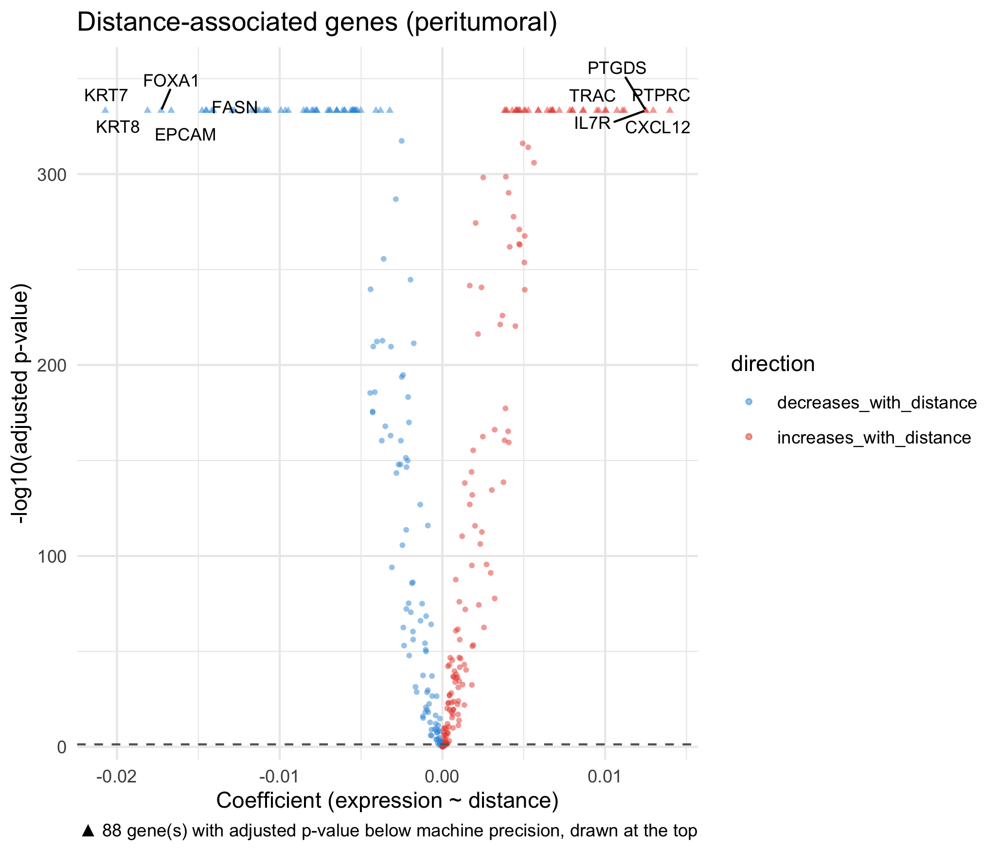
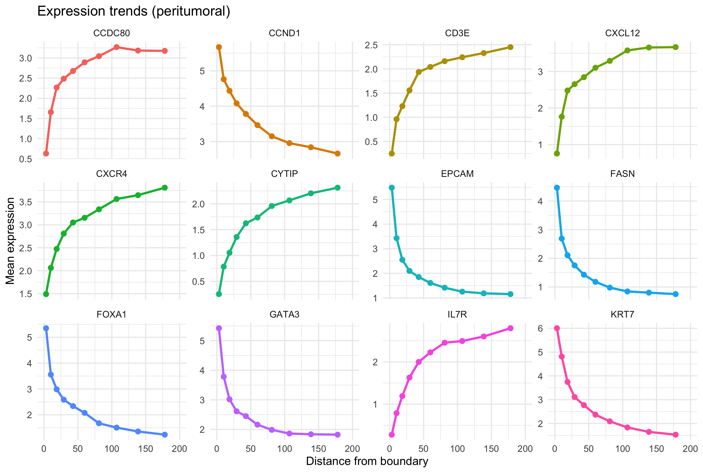

# Gene-Distance Analysis

## Introduction

stGradient provides tools to model individual gene expression as a
function of distance from tumor boundaries. This identifies genes whose
expression systematically increases or decreases with distance from the
boundary.

## Boundary Distance-Gene Analysis

### Step 1: Compute Signed Distance

First, compute a per-cell signed distance using a concave hull boundary:

``` r

library(stGradient)

seurat_obj <- compute_distance_from_boundary(
  seurat_obj,
  polygon_col = "inside_polygon",
  intratumoral_label = TRUE,
  fov_name = "fov",
  concavity = 2
)
```

This adds `dist_to_boundary` and `abs_dist_to_boundary` metadata
columns. Negative values indicate intratumoral cells, positive values
indicate peritumoral/stromal cells.

### Step 2: Find Distance-Associated Genes

Fit per-gene linear models and Spearman correlations:

``` r

dist_res <- find_distance_associated_genes(
  seurat_obj,
  assay = "Xenium",
  focus = "peritumoral",
  min_cells_expressing = 10,
  n_distance_bins = 10,
  max_dist_quantile = 0.95,
  max_distance = 200,
  p_adj_threshold = 0.05
)
```

`max_distance` caps how far from the boundary cells are included
(default 200). The smaller of `max_distance` and the `max_dist_quantile`
cutoff is used. The trends plot x-axis extends to `max_distance`.

#### Focus Options

| Focus            | Cells Analyzed                                        |
|------------------|-------------------------------------------------------|
| `"peritumoral"`  | Only cells outside the tumor boundary (distance \> 0) |
| `"intratumoral"` | Only cells inside the tumor boundary (distance ≤ 0)   |
| `"both"`         | All cells                                             |

### Step 3: Visualize Results

``` r

dist_plots <- plot_distance_genes(dist_res, top_n = 12, sample_label = "Sample_01")

# Volcano plot of gene significance
dist_plots$volcano

# Expression trends for top genes across distance bins
dist_plots$trends
```



## Interpreting Results

[`find_distance_associated_genes()`](../reference/find_distance_associated_genes.md)
returns a list containing:

- **`results`** — Per-gene model summary with slopes, correlations, and
  adjusted p-values
- **`binned_expr`** — Mean expression per distance bin for trending
  genes
- **`metadata`** — Analysis parameters and cell counts

Genes with significant positive slopes increase in expression away from
the boundary, while negative slopes indicate enrichment near the
boundary.

## Next Steps

- [Visualization](visualization.md) — comprehensive plotting functions
