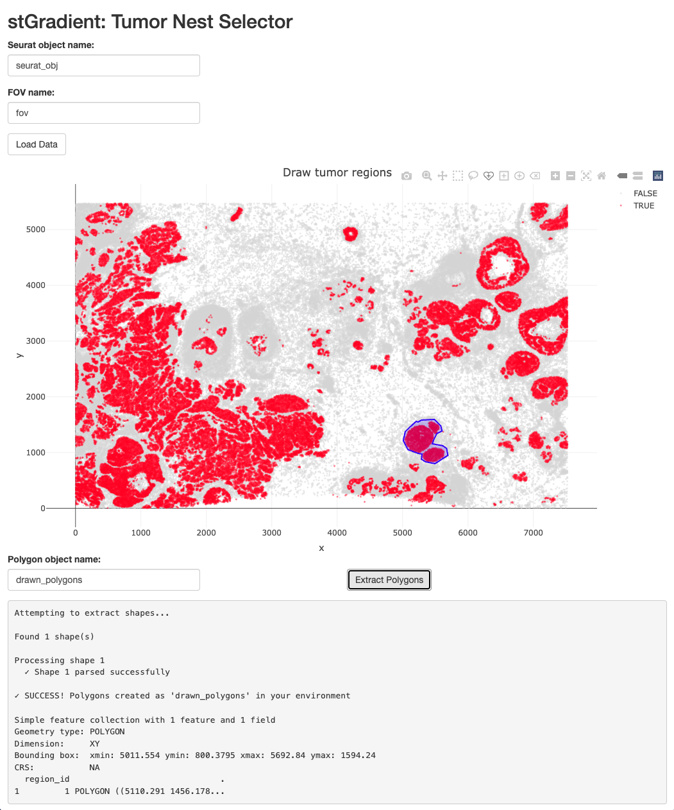
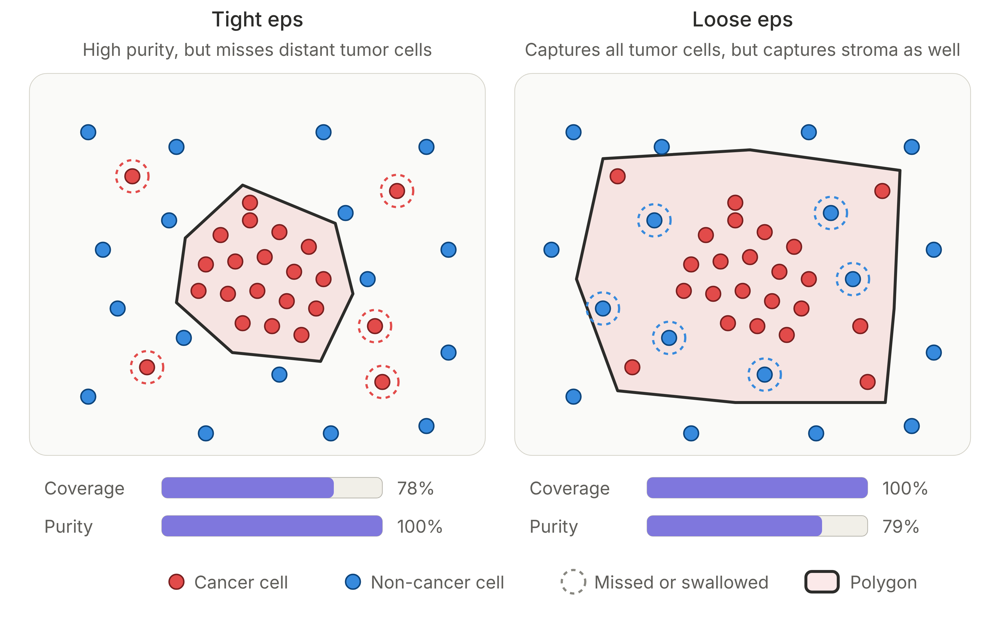
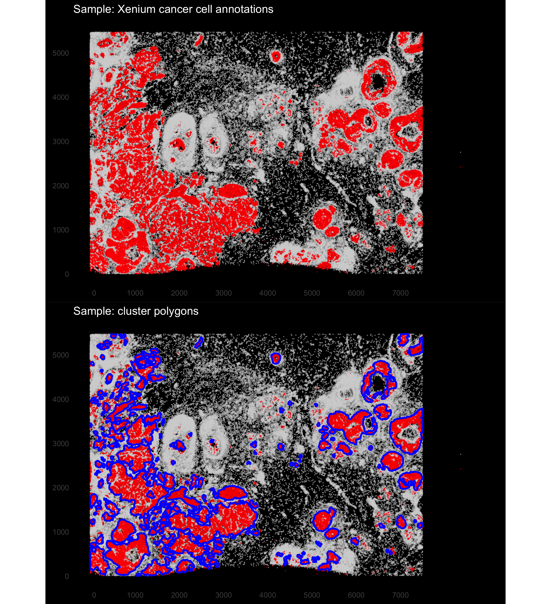
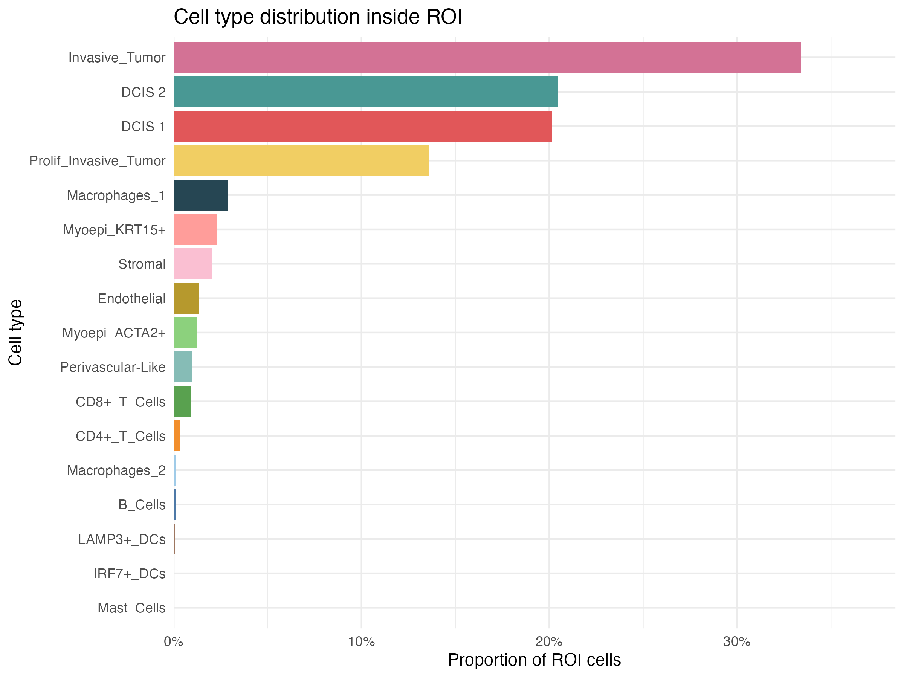
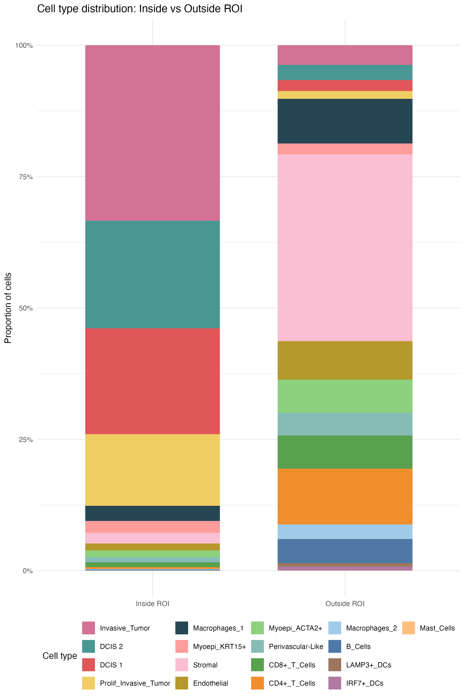
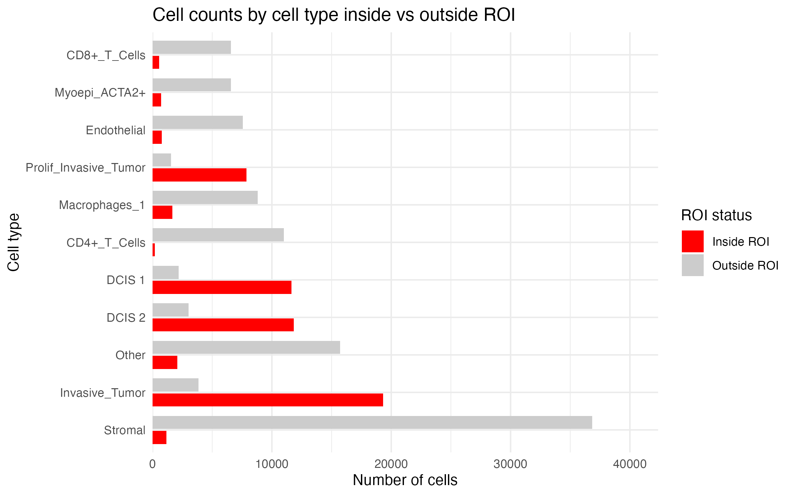

# Region Selection

## Introduction

stGradient provides two approaches for defining regions of interest
(ROIs):

1.  **Interactive selection** via the Shiny app
2.  **Automated detection** using DBSCAN clustering

## Launching the Interactive Polygon Selector

The Shiny app allows you to interactively draw polygons on spatial data
to define ROIs:

``` r

launch_stGradient()
```

### Workflow in the App

1.  **Enter your Seurat object name** — the name of the object in your R
    session
2.  **Enter FOV name** — the field of view name (typically `"fov"`)
3.  **Click “Load Data”** — loads cell coordinates and plots them
4.  **Draw polygons** — use the freehand drawing toolbar on the plot
5.  **Enter polygon object name** — name for the extracted polygon
    object
6.  **Click “Extract Polygons”** — saves polygons to your global
    environment

The resulting polygon object is an `sf` object that can be passed
directly to downstream stGradient functions. 

## DBSCAN-Based Polygon Detection

The [`add_dbscan_polygons()`](../reference/add_dbscan_polygons.md)
function automatically identifies ROIs by clustering cancer-labeled
cells using the DBSCAN algorithm, then wrapping detected clusters in
concave hull polygons.

### Using Known DBSCAN Parameters

If you already have starting values for `eps` and `minPts` (for example,
from a previous sample on the same platform), pass them directly:

``` r

library(stGradient)

seurat_obj <- add_dbscan_polygons(
  seurat_obj,
  eps = 35,         # neighborhood radius (microns)
  minPts = 20,      # minimum cluster size
  concavity = 2     # concave hull tightness (lower = tighter)
)

# Access the polygon object
auto_polygons <- get_cancer_regions(seurat_obj)
```

### Choosing Parameters Without Priors

If you don’t have prior values, you can optimize them from the data in
three steps:

1.  **Grid search.**
    [`optimize_dbscan_params()`](../reference/optimize_dbscan_params.md)
    runs DBSCAN on the cancer cells for every combination of `eps` and
    `minPts` in a grid and scores each combination by silhouette score,
    which measures how well separated the clusters are.
2.  **Filter out noisy settings.** DBSCAN labels a cancer cell as
    *noise* when it is not part of, or within `eps` of, a dense core (a
    cell with at least `minPts` neighbors within `eps`). Noise cells are
    not assigned to any cluster, so they fall outside every polygon.
    `noise_pct` is the fraction of cancer cells labeled noise. Settings
    with a high `noise_pct` miss many cancer cells, so only candidates
    below the `noise_pct` cutoff (default 15%) are scored further.
3.  **Compare coverage and purity.** For each remaining candidate,
    polygons are built and scored by `cancer_covered` (fraction of
    cancer cells that fall inside a polygon) and `purity` (fraction of
    cells inside polygons that are cancer). Larger `eps` or smaller
    `minPts` tends to raise coverage but pulls in more non-cancer cells,
    lowering purity. `fbeta` combines both into one score; with
    `b = 0.5`, purity counts more than coverage.



### Optimizing DBSCAN Parameters

[`optimize_dbscan_params()`](../reference/optimize_dbscan_params.md)
runs all three steps in one call. `noise_pct` sets the maximum fraction
of cancer cells labeled noise for a combination to be scored, `b` sets
the F-beta weighting, and `plot = TRUE` draws the coverage and purity
heatmap shown above. Results are sorted by `fbeta`, so the best
combination is in the first row:

``` r

results <- optimize_dbscan_params(
  seurat_obj,
  noise_pct = 0.15,  # keep combinations with < 15% of cancer cells as noise
  b = 0.5,           # weight purity more than coverage
  plot = TRUE        # draw the coverage vs purity heatmap
)

# View top parameter combinations
head(results)

# Use the best parameters
best <- results[1, ]
seurat_obj <- add_dbscan_polygons(seurat_obj, eps = best$eps, minPts = best$minPts)
```

The returned data frame has one row per `eps`/`minPts` combination with
`sil_score`, `n_clusters`, `noise_pct`, `n_regions`, `cancer_covered`,
`purity` and `fbeta`. Combinations above the `noise_pct` cutoff have
`NA` for the coverage, purity and `fbeta` columns. The heatmap is also
stored in `attr(results, "plot")` for saving.

You can customize the search ranges:

``` r

results <- optimize_dbscan_params(
  seurat_obj,
  noise_pct = 0.15,
  b = 0.5,
  plot = TRUE,
  eps_range = seq(20, 80, by = 10),
  minPts_range = c(15, 20, 30, 50),
  max_sample = 30000  # reduce for faster computation
)
```

### Visualizing Detected Polygons

Use [`plot_dbscan_polygons()`](../reference/plot_dbscan_polygons.md) to
inspect the results before proceeding:

``` r

# Plot with polygons overlaid
plot_dbscan_polygons(seurat_obj)

# Get polygons without plotting (useful for pipelines)
auto_polygons <- plot_dbscan_polygons(seurat_obj, plot = FALSE)
```



## Adding Polygon Membership

Once you have polygons (from either the Shiny app or DBSCAN), annotate
each cell as inside or outside:

``` r

# Add inside/outside metadata column
seurat_obj <- add_polygon_membership(seurat_obj, auto_polygons)
```

This adds an `inside_polygon` column to `seurat_obj@meta.data` with
logical values.

## QC Visualization

After assigning membership, use
[`qc_plot_xenium()`](../reference/qc_plot_xenium.md) to visualize the
spatial layout:

``` r

qc_out <- qc_plot_xenium(
  obj = seurat_obj,
  roi_col = "inside_polygon",
  celltype_col = "first_type",
  show = "both",
  zoom = TRUE,
  zoom_pad = 0.05,
  grey_outside_roi = TRUE
)
```


### ROI Composition Plots

Examine cell type distributions inside vs. outside the region:

``` r

# Distribution inside ROI only
plot_roi_celltype_dist(
  df = qc_out$df,
  roi_col = "inside_polygon",
  celltype_col = "first_type",
  metric = "proportion"
)
```



``` r

# Stacked inside vs outside
plot_roi_inout_celltype_stack(
  df = qc_out$df,
  roi_col = "inside_polygon",
  celltype_col = "first_type"
)
```



``` r

#Dodged inside vs outside
plot_roi_inout_celltype_dodge(
  df = qc_out$df,
  roi_col = "inside_polygon",
  celltype_col = "first_type",
  metric = "count",
  top_n = 10
)
```



## Next Steps

With regions defined and membership assigned, proceed to [Distance
Metrics](distance-metrics.md) to calculate boundary distances and
separation metrics.
