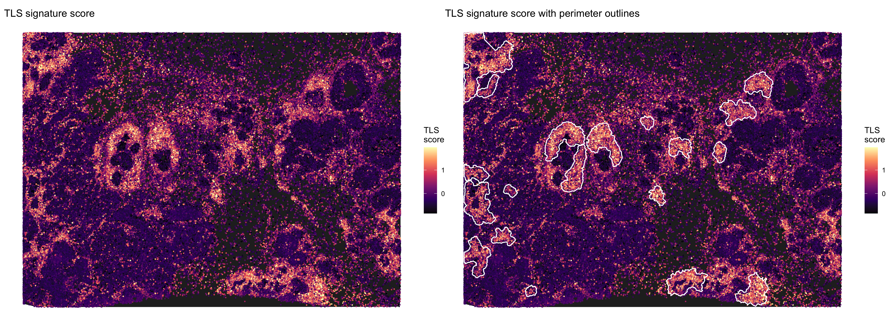
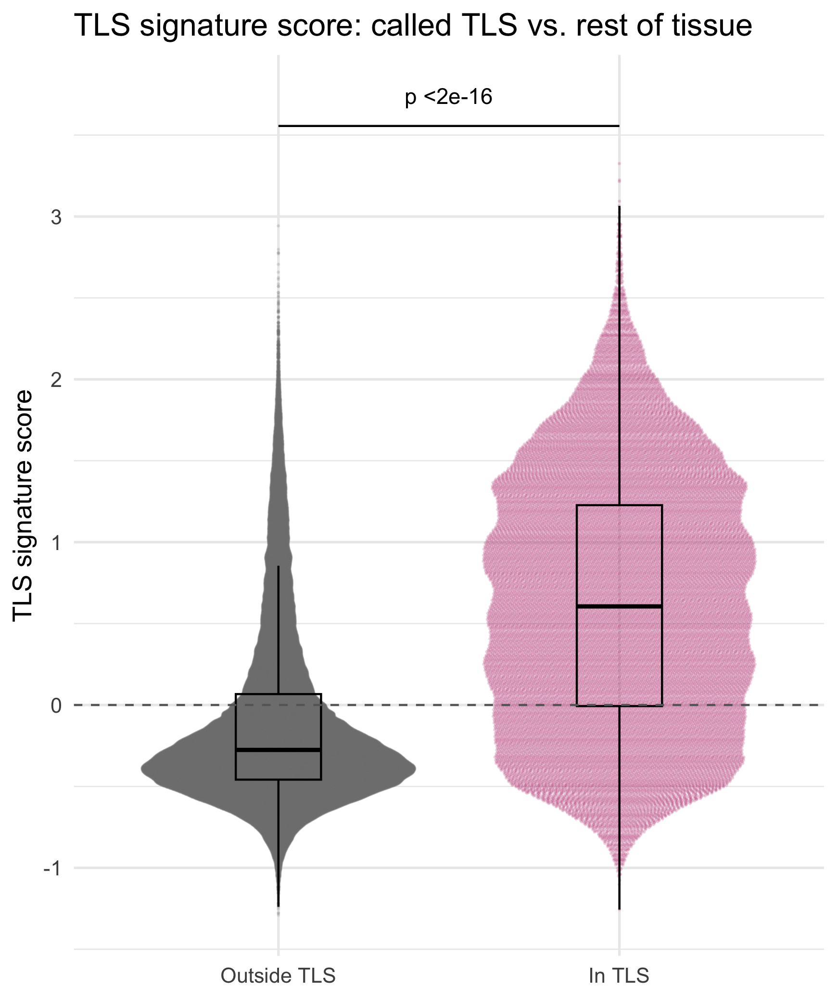

# TLS Analysis

## Introduction

Tertiary lymphoid structures (TLS) are organized aggregates of B cells,
T cells and dendritic cells that form in non-lymphoid tissue, including
tumors. stGradient detects TLS from cell type annotations and validates
the calls with a TLS gene signature score.

## Step 1: Call TLS From Cell Types

[`call_tls()`](../reference/call_tls.md) clusters B and T cells with
DBSCAN, assigns every cell within `eps` of a clustered lymphoid cell to
that aggregate, and calls an aggregate a TLS when it has at least
`min_B` B cells, `min_T` T cells, and a B cell fraction of at least
`min_frac_B`. This excludes pure T cell infiltrates. Aggregates that
contain mature dendritic cells (`dc_types`, e.g. LAMP3+/DC-LAMP+) are
flagged as `"mature-like (DC-LAMP+)"`.

``` r

library(stGradient)

seurat_obj <- call_tls(
  seurat_obj,
  fov_name = "fov",
  celltype_col = "first_type",
  b_types = c("B_Cells"),
  t_types = c("CD4+_T_Cells", "CD8+_T_Cells"),
  dc_types = c("LAMP3+_DCs", "IRF7+_DCs"),
  eps = 50,       # neighborhood radius (microns for Xenium)
  minPts = 20,
  min_B = 20,
  min_T = 20,
  min_frac_B = 0.05
)

# Per-TLS composition and maturity
get_tls_summary(seurat_obj)
```

This adds `TLS_id` (`NA` outside called TLS) and `in_TLS` metadata
columns. Use `get_tls_summary(seurat_obj, called_only = FALSE)` to see
all candidate aggregates, including those that failed the TLS criteria.

## Step 2: Visualize TLS Calls

``` r

# Spatial map: TLS colored by ID, B cells in red
plot_tls_map(seurat_obj, celltype_col = "first_type")

# Cell type composition of each TLS
plot_tls_composition(seurat_obj, celltype_col = "first_type")
```

## Step 3: Score a TLS Gene Signature

[`add_tls_score()`](../reference/add_tls_score.md) scores each cell with
[`Seurat::AddModuleScore()`](https://satijalab.org/seurat/reference/AddModuleScore.html)
using [`tls_signature_genes()`](../reference/tls_signature_genes.md) by
default. Genes missing from the panel are dropped.

``` r

tls_signature_genes()

seurat_obj <- add_tls_score(seurat_obj, assay = "Xenium")
```

If `AddModuleScore()` fails on a small panel, lower `nbin`
(e.g. `nbin = 12`).

## Step 4: Visualize the Signature Score

``` r

# Score with white perimeter outlines around each TLS
plot_tls_score(seurat_obj, highlight = "outline")

# Score with cyan rings on TLS cells and TLS ID labels
plot_tls_score(seurat_obj, highlight = "ring", label_tls = TRUE)

# Score only
plot_tls_score(seurat_obj, highlight = "none")
```



## Step 5: Check That Called TLS Score Higher

``` r

tls_stats <- summarize_tls_score(seurat_obj)
tls_stats$by_status   # in vs. outside TLS
tls_stats$by_tls      # per TLS, lowest mean score first
tls_stats$wilcox_p

plot_tls_score_comparison(seurat_obj, type = "beeswarm")
plot_tls_score_comparison(seurat_obj, type = "violin")
```



TLS with low mean scores in `tls_stats$by_tls` may be false positives
worth reviewing. The beeswarm plot uses the `ggbeeswarm` package if
installed.
