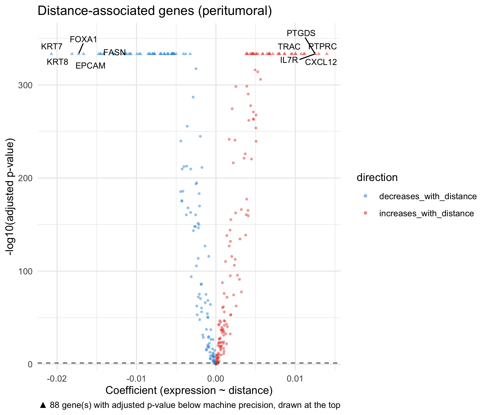
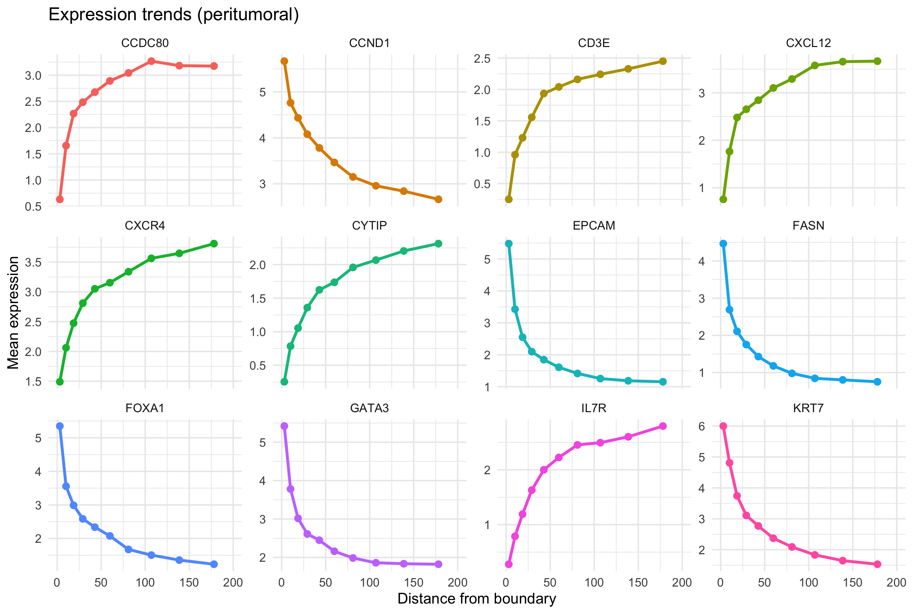

```{r setup, include=FALSE}
knitr::opts_chunk$set(
  collapse = TRUE,
  comment = "#>",
  eval = FALSE
)
```

## Introduction

stGradient provides tools to model individual gene expression as a function of distance from tumor boundaries. This identifies genes whose expression systematically increases or decreases with distance from the boundary.

## Boundary Distance-Gene Analysis

### Step 1: Compute Signed Distance

First, compute a per-cell signed distance to the cancer region polygons created by `add_dbscan_polygons()`:

```{r compute-dist}
library(stGradient)

seurat_obj <- add_dbscan_polygons(seurat_obj, fov_name = "fov")
seurat_obj <- compute_distance_from_boundary(seurat_obj, fov_name = "fov")
```

This adds `dist_to_boundary` and `abs_dist_to_boundary` metadata columns. Negative values indicate intratumoral cells, positive values indicate peritumoral/stromal cells. Distances are measured to the nearest region polygon, so they match `calculate_boundary_distances()` and stroma between separate tumor nests counts as peritumoral. To use other polygons, pass them with `polygons =`.

### Step 2: Find Distance-Associated Genes

Fit per-gene linear models and Spearman correlations:

```{r find-genes}
dist_res <- find_distance_associated_genes(
  seurat_obj,
  assay = "Xenium",
  focus = "peritumoral",
  min_cells_expressing = 10,
  n_distance_bins = 10,
  max_dist_quantile = 0.95,
  max_distance = 200,
  p_adj_threshold = 0.05
)
```

`max_distance` caps how far from the boundary cells are included (default 200). The smaller of `max_distance` and the `max_dist_quantile` cutoff is used. The trends plot x-axis extends to `max_distance`.

#### Focus Options

| Focus | Cells Analyzed |
|-------|---------------|
| `"peritumoral"` | Only cells outside the tumor boundary (distance > 0) |
| `"intratumoral"` | Only cells inside the tumor boundary (distance ≤ 0) |
| `"both"` | All cells |

#### Restricting to Cell Types

Use `celltype` with `celltype_col` to analyze specific cell types. A vector of types is pooled into one analysis; `celltype = "each"` runs the analysis separately for every cell type and returns a named list of results:

```{r find-genes-celltype, eval = FALSE}
# Only fibroblasts
fib_res <- find_distance_associated_genes(seurat_obj, celltype = "Fibroblast",
                                          celltype_col = "cellType")

# Each cell type separately
ct_res <- find_distance_associated_genes(seurat_obj, celltype = "each",
                                         celltype_col = "cellType")
ct_plots <- lapply(names(ct_res), function(ct) plot_distance_genes(ct_res[[ct]]))
```

Cell types with too few cells or expressed genes are dropped from the `"each"` output with a warning.

### Step 3: Visualize Results

```{r plot-dist-genes}
dist_plots <- plot_distance_genes(dist_res, top_n = 12, sample_label = "Sample_01")

# Volcano plot of gene significance
dist_plots$volcano

# Expression trends for top genes across distance bins
dist_plots$trends
```



## Interpreting Results

`find_distance_associated_genes()` returns a list containing:

- **`results`** — Per-gene model summary with slopes, correlations, and adjusted p-values
- **`binned_expr`** — Mean expression per distance bin for trending genes
- **`metadata`** — Analysis parameters and cell counts

Genes with significant positive slopes increase in expression away from the boundary, while negative slopes indicate enrichment near the boundary.

## Next Steps

- [Visualization](visualization.html) — comprehensive plotting functions
