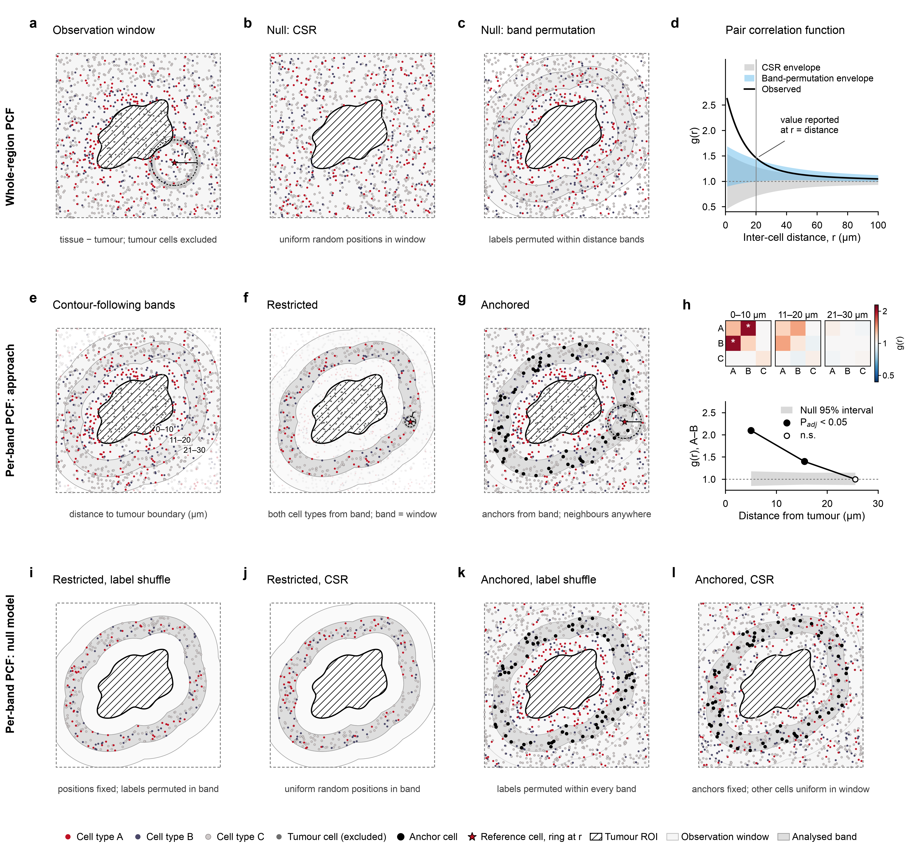
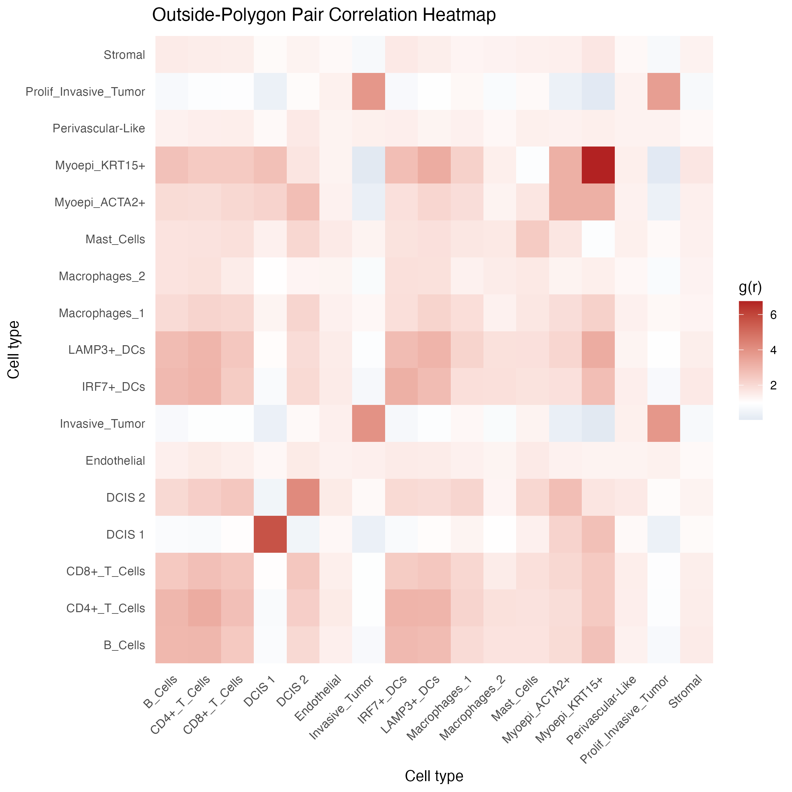
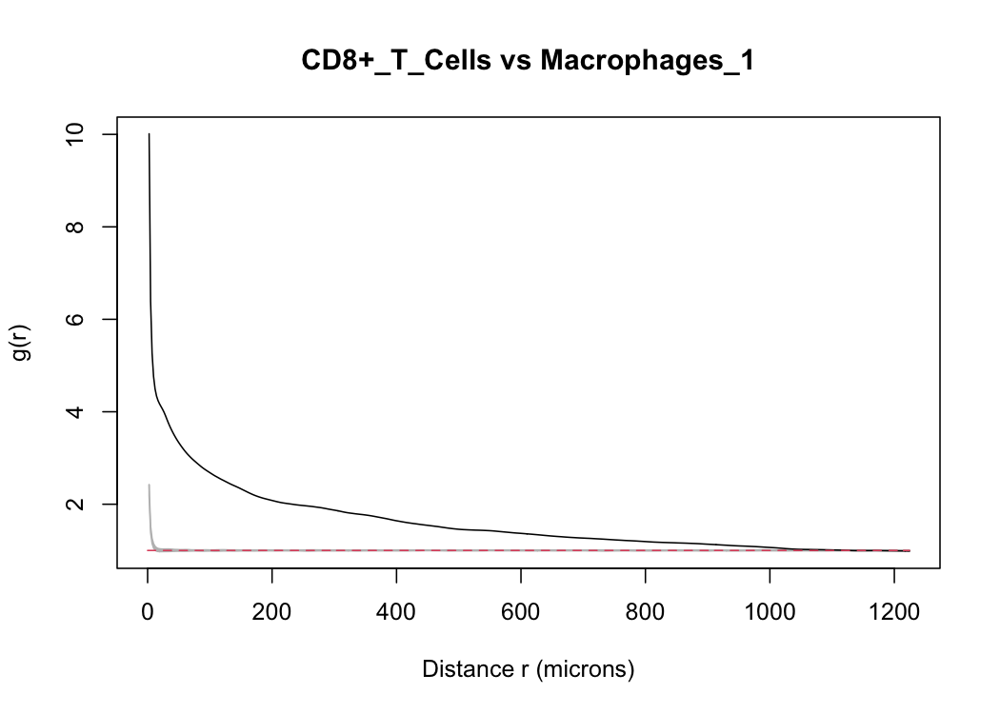
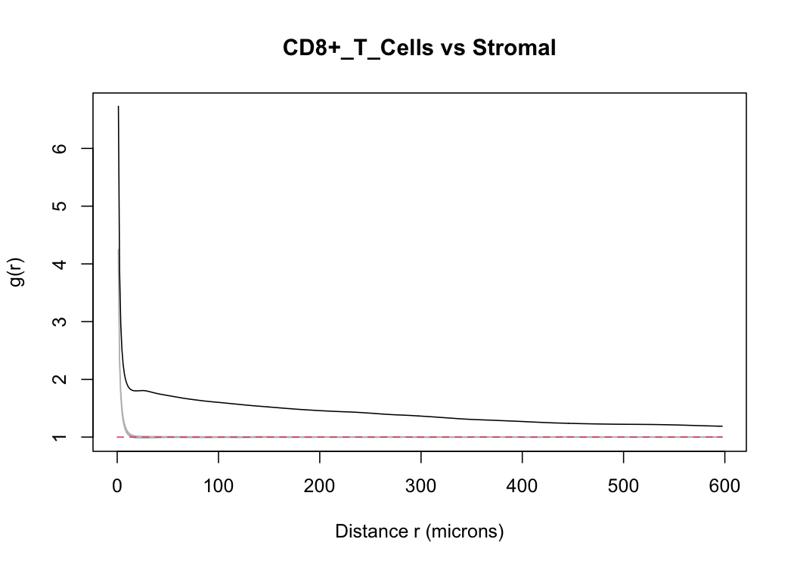

```{r setup, include=FALSE}
knitr::opts_chunk$set(
  collapse = TRUE,
  comment = "#>",
  eval = FALSE
)
```

## Introduction

stGradient includes optimized helpers for `spatstat`-based Pair Correlation Function (PCF) analysis. These functions specifically analyze spatial co-occurrence of cell types **outside** tumor polygons, characterizing the peritumoral microenvironment architecture.

### How the PCF works

The pair correlation function g(r) asks: around cells of type A, are cells of type B found at distance *r* more often than expected by chance? For each type-A cell, stGradient counts type-B cells in a thin ring of radius *r* and compares that count with what you would expect if type-B cells were spread evenly over the observation window. g(r) > 1 means the two types co-localize at that distance, g(r) ≈ 1 means no association, and g(r) < 1 means they avoid each other. Note that *r* is the distance **between two cells**, not the distance from the tumor.

The package offers two ways to run this analysis, shown in the figure below:

- **Whole-region PCF (panels a–d).** One g(r) per cell-type pair is computed over the entire outside-tumor region. The observation window is the tissue outline with the tumor polygons cut out (a), and cells inside the tumor are excluded. Significance comes from simulation envelopes under one of two null models: complete spatial randomness, which scatters cells uniformly across the window (b), or band permutation, which keeps cell positions and shuffles cell-type labels within bands that follow the tumor contour, so that a shared gradient away from the tumor is not mistaken for co-localization (c). The result is a g(r) curve with its envelope; the value at your chosen `distance` feeds the summary heatmap (d).
- **Per-band PCF (panels e–l).** `calculate_pcf_by_band()` splits the outside region into bands at increasing distance from the tumor boundary that follow its irregular outline (e) and computes g separately in each band, showing whether co-localization changes with distance from the tumor. Two approaches are available. **Restricted** (f) treats each band as its own window and uses only cells inside it; because bands are thin, keep *r* at or below the band width. **Anchored** (g) takes the anchor cell type from the band but counts neighbors anywhere outside the tumor, which allows larger *r* and gives directional results (A→B differs from B→A). Results are returned as one heatmap per band and as a profile of g across bands (h). Each approach can be tested against a label-shuffle null, which keeps positions and permutes cell types (i, k), or a CSR null, which relocates cells uniformly (j, l).



*Overview of the PCF options (schematic with simulated cells). **a–d**, Whole-region PCF: the observation window (tissue minus tumor), the two null models (`"csr"` and `"band_permutation"`), and the g(r) curve with its envelope. **e–h**, Per-band PCF with `calculate_pcf_by_band()`: bands follow the tumor contour; the `"restricted"` approach uses only cells in the band, the `"anchored"` approach takes anchor cells from the band and neighbors from anywhere outside the tumor; outputs are per-band heatmaps and a profile across bands. **i–l**, The per-band null models (`"label_shuffle"` and `"csr"`) for each approach.*

## Prerequisites

PCF analysis requires the `spatstat.geom` and `spatstat.explore` packages:

```{r prereqs}
install.packages(c("spatstat.geom", "spatstat.explore"))
```

You also need a Seurat object with polygons defined (see [Region Selection](region-selection.html)).

## Computing PCF Summary

Calculate cross-type PCF values at a specific target distance:

```{r pcf-summary}
library(stGradient)

pcf_summary <- calculate_pcf_outside_summary(

  seurat_obj = seurat_obj,
  polygons = auto_polygons,
  distance = 200,
  min_cells = 10,
  celltype_col = "first_type",
  include_self_pairs = TRUE,
  ordered_pairs = FALSE
)

```

### Parameters

- `distance` — target radius (microns) at which to evaluate the PCF
- `min_cells` — minimum cells per cell type to include in the analysis
- `include_self_pairs` — whether to compute same-type PCF (e.g., A-A)
- `ordered_pairs` — `FALSE` computes each pair once (A-B); `TRUE` computes both (A-B and B-A)
- `tissue_window` — tissue outline used as the observation window: `"concave"` (default, concave hull of all cells), `"convex"`, or `"bbox"`. Tumor polygons are always removed from the window, since outside cells cannot occur there; leaving them in biases g(r) upward. Pass your own tissue outline with `window_obj`.
- `bw` — kernel bandwidth in microns (default 10). Use the same `bw` here and in `plot_pcf_outside_pair_envelopes()` so heatmap values match the envelope curves.

### Interpreting PCF Values

| PCF Value | Interpretation |
|-----------|---------------|
| g(r) = 1 | Random spatial distribution (CSR) |
| g(r) > 1 | Spatial clustering / attraction |
| g(r) < 1 | Spatial repulsion / inhibition |

## Heatmap Visualization

Visualize all pairwise PCF values as a heatmap:

```{r heatmap}
plot_pcf_outside_heatmap(pcf_summary, midpoint = 1)
```


The midpoint at 1 represents complete spatial randomness, with warm colors indicating co-occurrence and cool colors indicating avoidance.

## Envelope Curves

Generate Monte Carlo envelope curves for all cell-type pairs to assess statistical significance:

```{r envelopes}
env_list <- plot_pcf_outside_pair_envelopes(
  seurat_obj = seurat_obj,
  polygons = auto_polygons,
  celltype_col = "first_type",
  min_cells = 10,
  include_self_pairs = FALSE,
  ordered_pairs = FALSE,
  nsim = 39,
  bw = 10,
  null_model = "band_permutation",
  band_width = 25,
  file = "pcf_outside_all_pairs.png"
)
```


This saves one PNG per cell-type pair (e.g. `pcf_outside_all_pairs_TypeA_vs_TypeB.png`) showing the observed PCF against simulation envelopes.

### Global vs. Pointwise Envelopes

`envelope_type` controls how the envelope can be read:

- `"global"` (default) — a simultaneous envelope over the distance range `r_range` (default: from `bw` up to the largest distance computed). If the observed curve leaves the band anywhere in that range, the pattern differs from the null at significance level `1 / (nsim + 1)`, e.g. 0.05 for `nsim = 19` and 0.01 for `nsim = 99`. Each envelope also carries a MAD test p-value in `attr(env, "p_value")`. The band has the same width at every distance.
- `"pointwise"` — a separate envelope at each distance, with a two-sided significance level of `2 / (nsim + 1)` at each single distance. Scanning the curve for any distance outside the band inflates false positives (in simulations, about half of random-label datasets left a 19-simulation pointwise envelope somewhere between 10 and 80 µm), so use it only for a distance chosen in advance.

### Choosing a Null Model

`null_model` sets what the envelopes are simulated under:

- `"csr"` (default) — cells placed uniformly at random in the outside-tumor window with independent labels. Tissue is rarely uniform, so most pairs will fall outside these envelopes.
- `"band_permutation"` — cell positions are kept and cell-type labels are shuffled among cells in the same distance band from the tumor boundary (`band_width` microns wide). Two cell types that are both enriched near the tumor will not appear co-localized just because of that shared gradient. Set `band_width = Inf` to shuffle labels across all outside cells.

## Single-Pair PCF Plot

For focused analysis of specific cell-type pairs:

```{r single-pair}
plot_pcf_pair_gg(env_list, "TypeA", "TypeB")
```




## PCF by Distance Band

`calculate_pcf_by_band()` splits the outside-tumor region into bands that follow the tumor contour (e.g. 0–50, 50–100, 100–150 µm from the boundary) and computes g(r) for every cell-type pair separately in each band. This shows whether co-localization changes with distance from the tumor.

```{r pcf-by-band}
band_pcf <- calculate_pcf_by_band(
  seurat_obj = seurat_obj,
  polygons = auto_polygons,
  celltype_col = "cellType",
  band_width = 50,          # or band_breaks = c(0, 25, 50, 100, 200)
  max_distance = 200,
  approach = "restricted",  # or "anchored"
  distance = 20,            # cell-to-cell r; can be a vector
  null_model = "label_shuffle",
  nsim = 99
)

plot_pcf_band_heatmap(band_pcf)    # one heatmap per band, * = p_adj < 0.05
plot_pcf_band_profile(band_pcf)    # g vs. distance from tumor, per pair
```

Two approaches:

- `"restricted"` — each band is its own window; both cell types come from the band. Answers "within this band, are B cells concentrated around A cells, given the band's cell mix?". Bands are thin, so keep `distance` at or below the band width.
- `"anchored"` — anchor (type 1) cells come from the band; neighbor (type 2) cells can be anywhere outside the tumor. Answers "around A cells in this band, how dense are B cells at distance r?". Directional, so ordered pairs are used. Larger `distance` values are usable.

Null models (`nsim` simulations, two-sided Monte Carlo p-value per band, pair and distance; `p_adj` is BH-adjusted across all of them):

- `"label_shuffle"` — positions kept, labels permuted within the band (anchored: within every band, preserving the tumor gradient).
- `"csr"` — restricted: cells relocated uniformly within the band; anchored: anchors fixed, all other cells relocated uniformly in the outside window. Also flags ordinary clumping and, for anchored, the tumor gradient.
- `"none"` — observed g only.

In anchored mode, raw g is high for every anchor type near the tumor because neighbor density there is higher than average. Use `plot_pcf_band_heatmap(band_pcf, value = "g_over_null")` to show g relative to the null. The band polygons are stored in `attr(band_pcf, "bands")` for plotting.

## Notes

- These PCF helpers analyze **only cells outside polygons** by design
- `nsim` is required; more simulations take longer. With `null_model = "band_permutation"` and a global envelope, `2 * nsim` permutations are run (the second set estimates the null mean)
- The `bw` parameter controls PCF bandwidth smoothing and defaults to 10 µm in both the summary and the envelopes
- Underlying computation uses the `spatstat` ecosystem

## Next Steps

- [Gene-Distance Analysis](gene-distance-analysis.html) — model gene expression as a function of boundary distance
